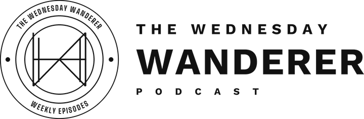
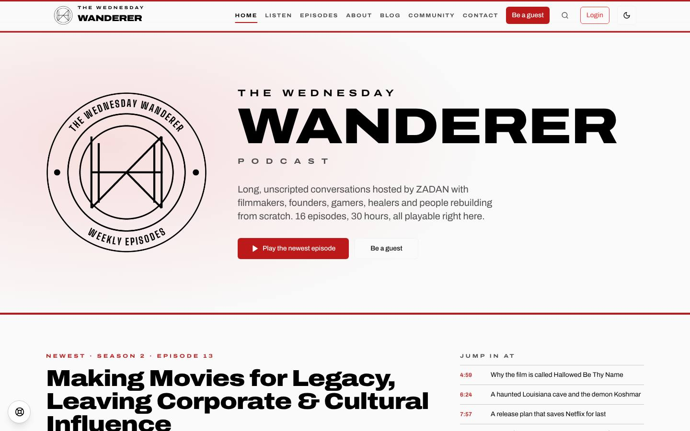
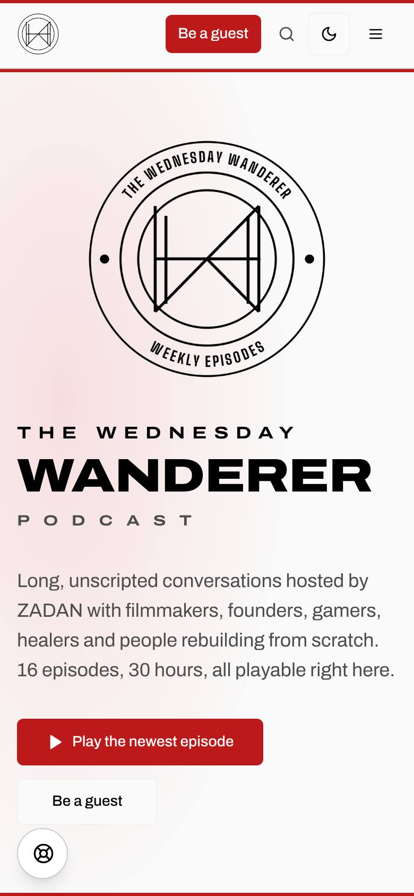

  <picture>
    <source media="(prefers-color-scheme: dark)" srcset="assets/logo-dark.png" />
    
  </picture>

<h1 align="center"><a href="https://twwpodcast.xyz">The Wednesday Wanderer</a></h1>

  The official site for The Wednesday Wanderer, a long-form interview podcast hosted by Michael "ZADAN" Isbell. Each episode is an unhurried, real-time conversation with someone from a different walk of life. Every episode plays right on the site, with summaries, timestamps and a full searchable transcript.

<strong>Live site:</strong> <a href="https://twwpodcast.xyz">twwpodcast.xyz</a>

  <a href="#what-it-is">What it is</a> · <a href="#features">Features</a> · <a href="#book-or-get-in-touch">Get in touch</a> · <a href="#connected-brands">Connected brands</a>

  
  
  
  

<table>
  <tr>
    <td align="center" valign="top">
       
      The home page on desktop.
    </td>
    <td align="center" valign="top">
       
      The same page on a phone.
    </td>
  </tr>
</table>

## What it is

The Wednesday Wanderer is a weekly interview podcast hosted by ZADAN under Zathena Ventures and produced by Zathena Ventures Productions. The conversations are long-form, authentic and recorded in real time, with guests from all walks of life.

The site is the show's home base. You can listen to the whole back catalog without leaving the browser, read along with the transcript, follow up on what a guest mentioned, and apply to be a guest yourself.

## Features

### Listening

- **[Player](https://twwpodcast.xyz/player) that stays put**: it docks while you browse, so the episode keeps playing as you move around the site
- **Listen your way**: a queue, speed control, resume points and media-key support
- **Every episode in one place**: the full list on the [episodes page](https://twwpodcast.xyz/episodes)

### Episode pages

- **Summary and timestamps**: see what an episode covers and jump to the topic you want
- **Host's notes and guest links**: the original notes from the host and links to follow each guest
- **Full transcript**: searchable, so you can find the line you half-remember

### For listeners

- **Member accounts**: favorites and playlists that follow you between devices
- **[Blog](https://twwpodcast.xyz/blog)**: companion posts to the episodes
- **[Community](https://twwpodcast.xyz/community)**: the show's community page
- **Comfortable to use**: light and dark mode, an accessibility menu and site search

## Book or get in touch

- **[Apply to be a guest](https://twwpodcast.xyz/apply)**: send an application and request a 30 minute intro call
- **[Contact the show](https://twwpodcast.xyz/contact)**: for anything else
- **[About the show](https://twwpodcast.xyz/about)**

## Connected brands

- **[Zathena Ventures](https://zathenaventures.xyz)**: built and hosts the site, and produces the show through Zathena Ventures Productions ([public repo](https://github.com/ZATHENA-VENTURES/ZathenaVentures-Public))
- **[ZADAN](https://github.com/ZATHENA-VENTURES/ZADAN-Public)**: the host
- **[Michael B. Hughes-Isbell Portfolio](https://michaelbisbell.com)**: Michael's personal site, a separate brand in the same ecosystem ([public repo](https://github.com/ZATHENA-VENTURES/MBIM-Public))

## License

© 2026 Zathena Ventures. All rights reserved.

## Credits & Contact

Produced by Zathena Ventures Productions. Built and hosted by [Zathena Ventures](https://zathenaventures.xyz).

Website: [twwpodcast.xyz](https://twwpodcast.xyz) · Contact: [twwpodcast.xyz/contact](https://twwpodcast.xyz/contact)

> This is the public showcase of a private repository. It presents the project, its features and its live site, and leaves out source code and deployment details.
